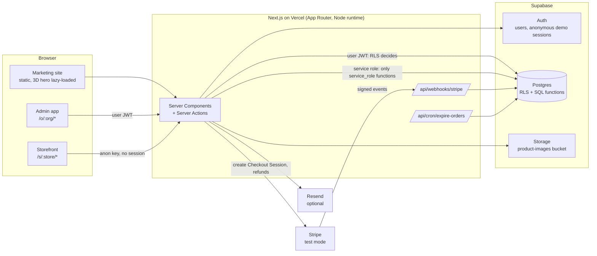
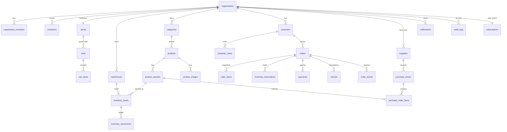
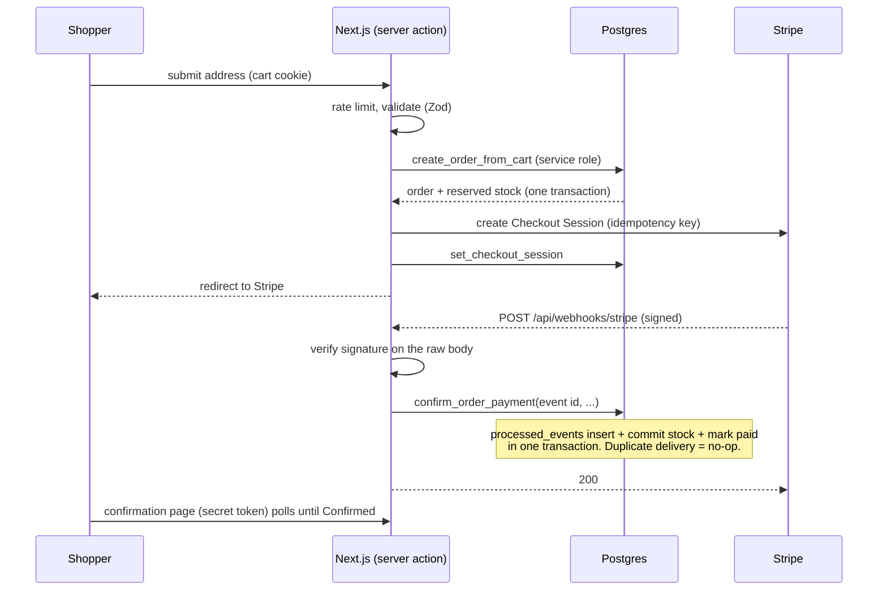

# Architecture

## System overview



## The one idea behind everything

**Authorization and invariants live in the database; the application is a thin, validated client of them.**

| Concern | Where it is enforced |
|---|---|
| Tenant isolation | Row Level Security on every tenant table (`is_member()`, `can_read_org()`), plus **composite foreign keys** `(child_id, organization_id)` so a row can't even *reference* another tenant's row |
| Roles | `member_role` enum ordered `staff < manager < admin < owner`; every write policy / function checks a minimum role |
| Stock correctness | `CHECK (reserved <= on_hand)`, an append-only `inventory_movements` ledger, and row-locked SQL functions (no direct writes) |
| Order state | No client write policies on `orders`; only `update_fulfillment`, `cancel_order`, `record_refund` and service-only functions change it |
| Payment idempotency | Stripe event id inserted into `processed_events` **in the same transaction** as its effect |
| Public storefront | Shoppers have *no table privileges*; they call `storefront_*` / `cart_*` functions that return a fixed set of fields |

The app code still re-checks (`requireOrgAccess`, `hasRole`) for good error messages and defense in depth, but removing it would not open a hole.

### Why the Supabase client + SQL functions, not Drizzle
RLS needs the caller's JWT to reach Postgres. The Supabase client does that natively; Drizzle would connect as a privileged role and bypass RLS unless the claims plumbing were rebuilt. Transactional workflows (reserve stock, commit payment) are Postgres functions so each is one atomic transaction. Results are validated at the boundary with Zod rather than trusted from generated types (run `supabase gen types` if you prefer; the schemas would then be the second line of defense).

## Data model (core relationships)


Supporting tables: `profiles`, `order_counters`, `po_counters` (per-org numbering), `processed_events` (webhook idempotency), `rate_limit_hits`. 31 tables and 66 functions in 8 migrations (`supabase/migrations`).

Key decisions:
- **Money** is integer minor units plus an ISO currency, never floats.
- **Order items snapshot** name, SKU and price, so history survives catalog edits.
- **Segments, stock availability, valuation** are computed, not stored, so they can't drift.
- **Per-organization order and PO numbers** come from counter tables (row-locked upsert) so numbers don't collide under concurrency.

## Stock and order lifecycle

```mermaid
stateDiagram-v2
  [*] --> Pending: create_order_from_cart<br/>reserved += n
  Pending --> Confirmed: confirm_order_payment (webhook)<br/>on_hand -= n, reserved -= n, 'sale' movement
  Pending --> Cancelled: expiry / session expired / staff cancel<br/>reserved -= n
  Cancelled --> Confirmed: payment arrives late and stock still available
  Cancelled --> RefundNeeded: payment arrives late and stock is gone
  Confirmed --> Shipped --> Delivered
  Confirmed --> Cancelled: full refund + restock<br/>on_hand += n, 'return' movement
```

## Checkout request flow



## Folder map

```
app/
  (auth)/ login, signup        onboarding/       invite/[token]/
  o/[orgSlug]/...              admin app (dashboard, orders, customers, products, inventory,
                               suppliers, purchase-orders, analytics, storefront, settings, notifications)
  s/[storeSlug]/...            storefront (home, products, category, product, cart, checkout, order, track)
  api/webhooks/stripe, api/cron/expire-orders
  actions/                     server actions (auth, products, inventory, orders, checkout, cart, purchasing, team, crm)
components/  marketing/ app/ store/ ui/
lib/         authz, supabase/{server,public,admin,middleware}, validators/, stripe*, rate-limit, emails, csv, ...
supabase/    migrations/ seed.sql
tests/       db/ (in-process Postgres), unit and component tests      e2e/  Playwright
```
